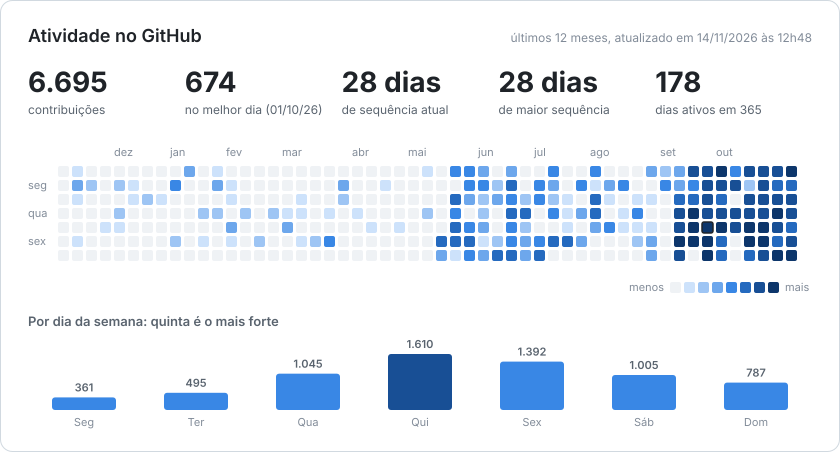

# Gabriel Souza

Engenheiro de software. Sou sócio da [Fior & Souza](https://fiorsouza.com.br), onde cuido da engenharia e da plataforma dos nossos produtos, e fundador da Nuvem Company.

Gosto de software que vai pra produção e fica lá: com usuário de verdade, dado sensível e gente dependendo dele no meio do plantão.

## Produtos

| Produto | O que é |
|---|---|
| [**Leito360**](https://leito360.com.br) | Sistema hospitalar que nasceu num plantão de UTI e cresceu até cobrir o hospital inteiro. Em produção. |
| [**PalcoPro**](https://palcopro.com.br) | A casa de quem vive de evento: a locadora que aluga o equipamento, a equipe que monta e opera e, em breve, o músico que vende o show. |

## Open source

- [**pluck**](https://github.com/DevGabrielSouza/pluck): app desktop pro yt-dlp, feito com PySide6 e QML.
- [**ZapZap**](https://github.com/rafatosta/zapzap): contribuições no cliente de WhatsApp pra Linux, como a lista de conversas redimensionável e o JavaScript customizado rodando sob a CSP do WhatsApp Web.
- [**nest-boilerplate**](https://github.com/DevGabrielSouza/nest-boilerplate): ponto de partida pra API em NestJS.

## Stack

TypeScript de ponta a ponta, do banco à tela, com modelagem de domínio (DDD) e IA no fluxo de desenvolvimento.

## Atividade

<picture>
  <source media="(prefers-color-scheme: dark)" srcset="https://raw.githubusercontent.com/DevGabrielSouza/devgabrielsouza/activity/activity-dark.svg">
  
</picture>

Atualizado a cada 3 horas por um workflow deste repositório, a partir do calendário de contribuições.

## Contato

[LinkedIn](https://www.linkedin.com/in/devgabrielsouza/) · [Instagram](https://www.instagram.com/devgabrielsouza/) · [gabriel@nuvemcompany.com.br](mailto:gabriel@nuvemcompany.com.br)
